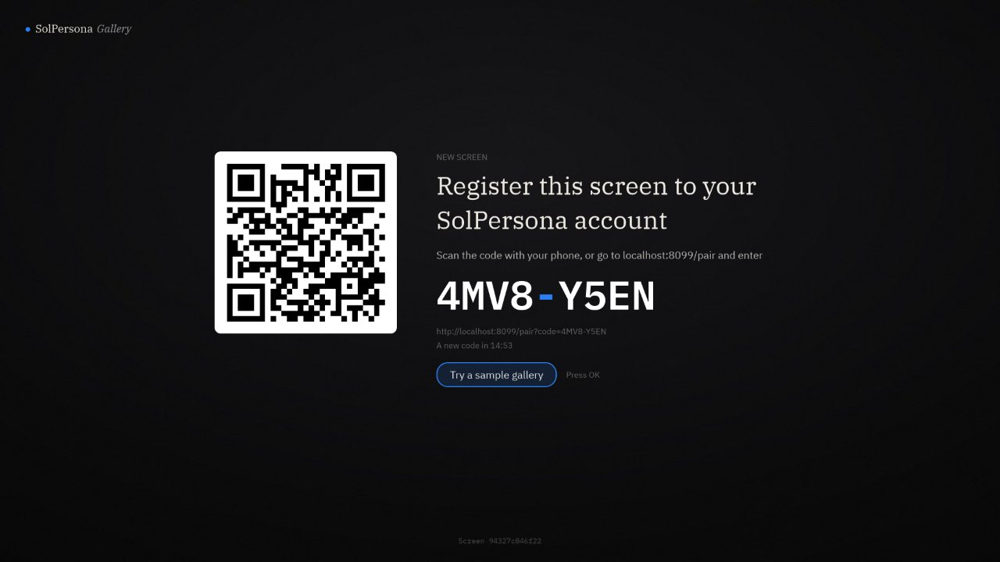
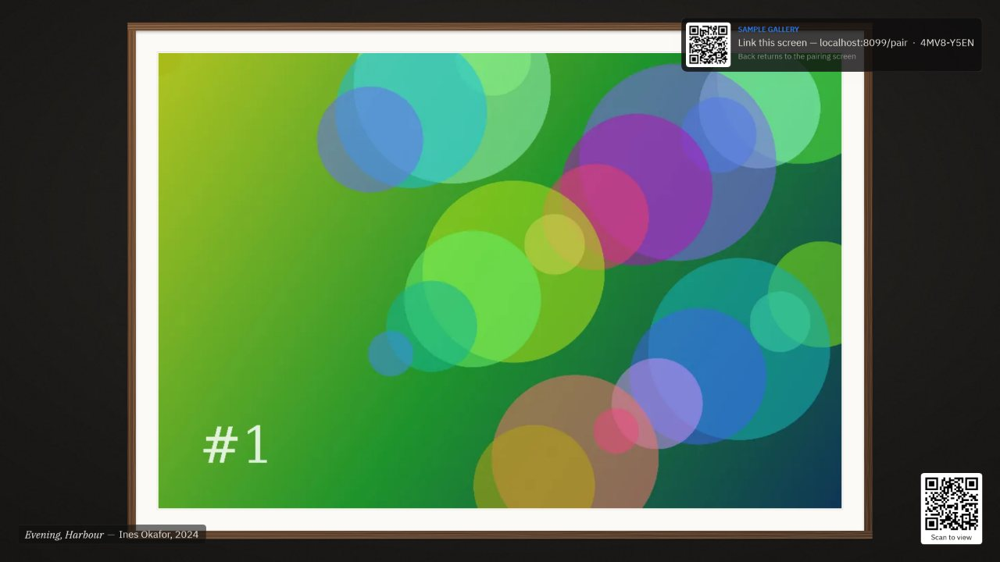
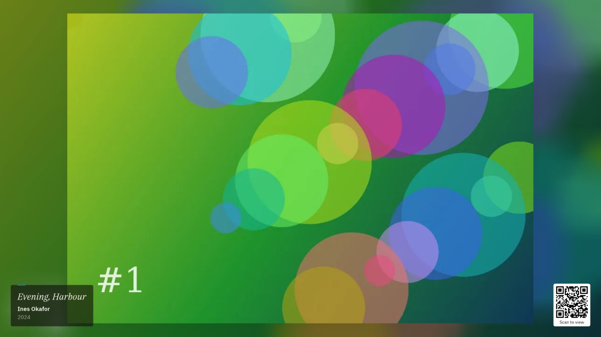
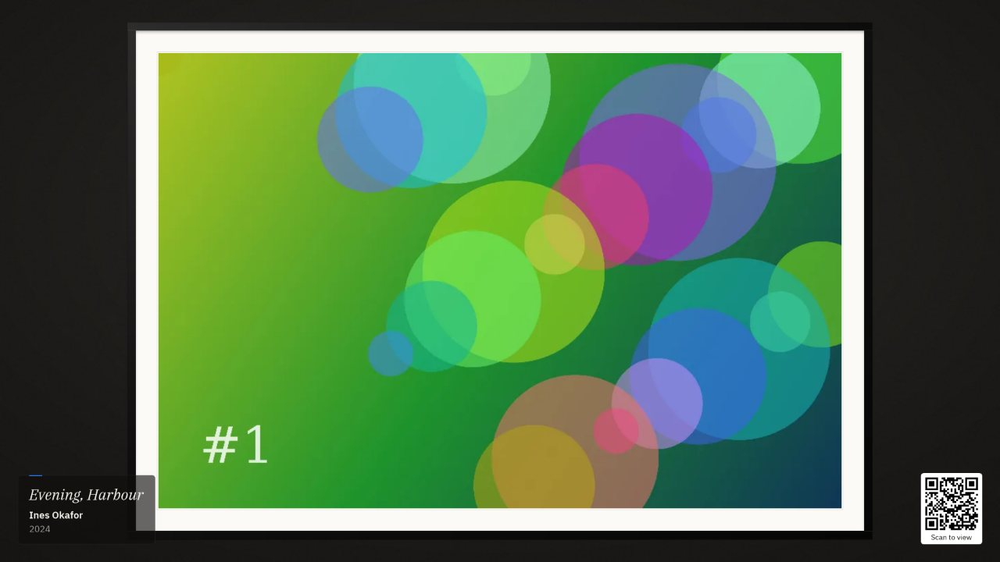
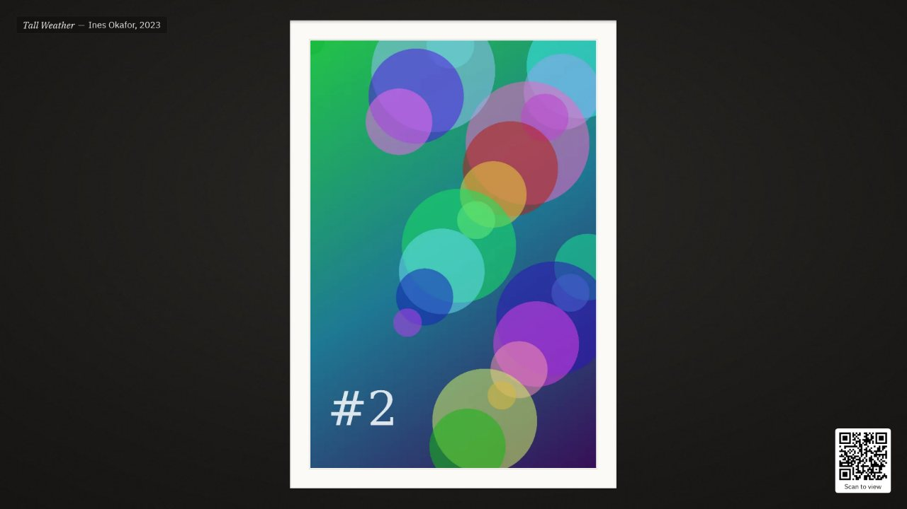
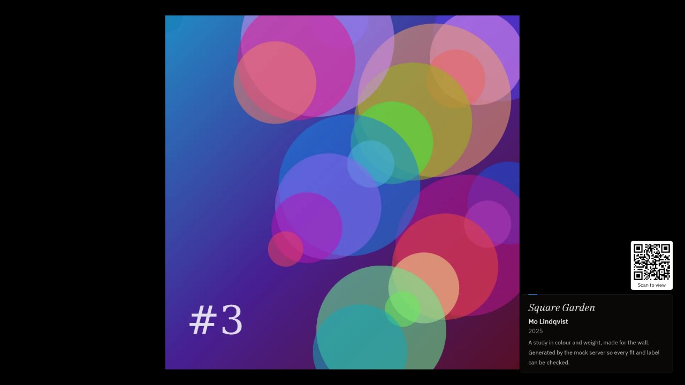
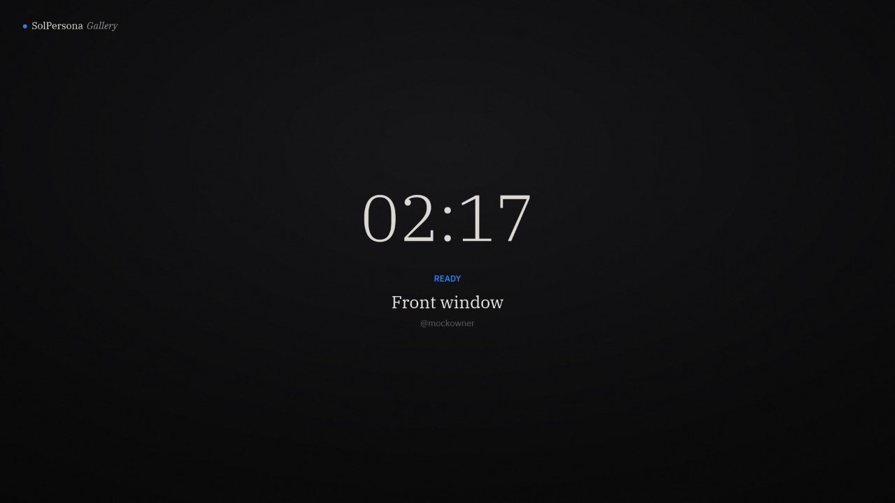
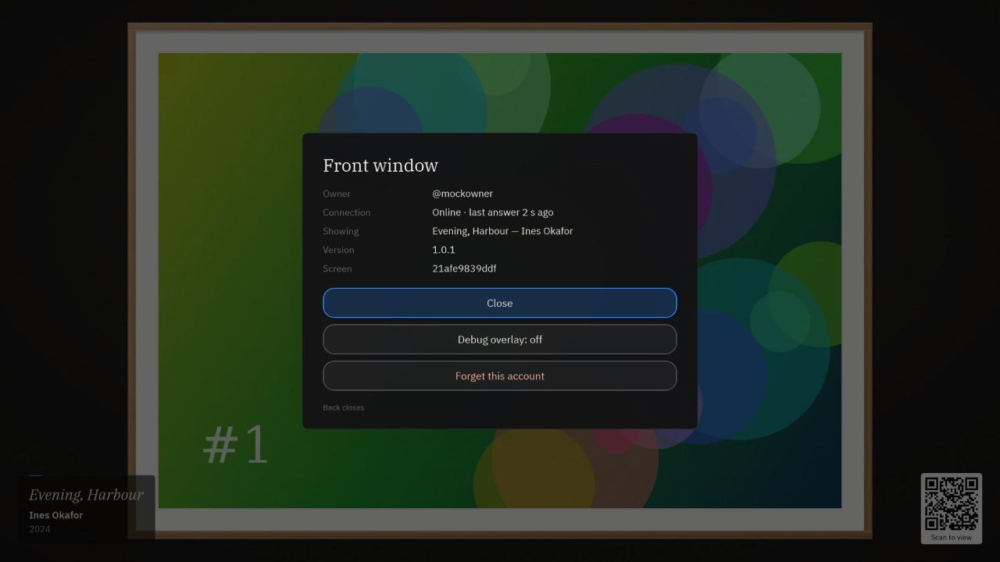

# SolPersona Gallery for Roku

A Roku channel that turns a Roku TV or Roku streaming player into a gallery
screen for [SolPersona](https://solpersona.com), the artist identity and
portfolio platform. Install it, open it, scan the QR code with your phone and
link the screen to your SolPersona account. From then on you choose what it
shows from SolPersona's dashboard: a gallery, how it is framed, when the wall
opens and closes, and which piece takes over the screen right now.

Several screens showing the same gallery stay in step because they share a
clock; they never talk to each other. The contract with SolPersona is
[`docs/solpersona/SPEC.md`](docs/solpersona/SPEC.md).

| | |
|---|---|
|  |  |
| Pairing: scan, or type the code at solpersona.com/pair | Try a sample gallery, with the way to link kept in a corner |
|  |  |
| BLUR: the piece over a soft wash of itself, museum card, QR | FRAME: mat and moulding (five styles) |
|  |  |
| Mat only, one-line label in the top-left corner | BLACK, with the code above a museum card in one corner |
|  |  |
| Linked, nothing playing | OK on the remote |

<sub>Screenshots are rendered by the BrightScript Simulation Engine against
`tools/mock-server.mjs` (generated test art), at 1920×1080. Hardware results
are in [`docs/CONFORMANCE-RESULTS.md`](docs/CONFORMANCE-RESULTS.md).</sub>

## Sideload in five steps

1. **Developer mode on the Roku.** With the Roku remote press
   Home ×3, Up ×2, Right, Left, Right, Left, Right. Accept the agreement, choose
   a password, and note the address it shows (e.g. `http://192.168.1.40`).
2. **Get the code and tools.** Node 24 or newer (`.nvmrc` pins 24) and `make`:
   ```sh
   git clone <this repo> && cd solpersona-gallery-roku
   npm ci
   ```
3. **Tell the tools where the Roku is.** Create `.env` (git-ignored):
   ```sh
   ROKU_IP=192.168.1.40
   ROKU_PASSWORD=the-password-you-chose
   ```
4. **Build and install.**
   ```sh
   make dev        # = make zip + make sideload
   ```
   (Or upload `build/solpersona-gallery-roku.zip` on the Roku's web page,
   `http://<ROKU_IP>`, user `rokudev`.)
5. **Link it.** The TV shows the pairing screen. Scan the QR code with your
   phone, sign in to SolPersona and press **Link this screen**. The gallery
   appears within a few seconds.

## Using it

The wall is controlled from SolPersona's dashboard (**Dashboard → Gallery
Exhibition**). The remote only needs three keys:

| Key | Pairing screen | Playing |
|---|---|---|
| **OK** | Try a sample gallery | Overlay: screen name, owner, connection, what is showing, version, **Debug overlay**, **Forget this account** |
| **Back** | Leave the gallery? | Closes the overlay; otherwise asks **Leave the gallery?** (no accidental exits) |
| **★** | Five times: developer menu | The overlay |

### Configuration (hidden developer menu)

On the pairing screen press **★ five times** within five seconds:

- **SolPersona address** — the base URL, `https://solpersona.com` by default.
  "Enter an address…" opens a keyboard (e.g. `http://192.168.1.20:8080` for a
  development stack). Changing it forgets this screen's link: a credential
  belongs to the SolPersona that issued it.
- **Name offered when registering** — the suggested screen name.
- **Debug overlay** — the simulator's D panel: sync status and latency, clock
  offset, show and version, position and slot progress, cache, kept files,
  commands, recent requests. Never the token.
- **Keep the screen awake** — see [Screensaver](#screensaver-and-power).

Sideloaded builds also accept launch parameters, handy for scripts:
```sh
curl -d '' "http://$ROKU_IP:8060/launch/dev?baseUrl=http://192.168.1.20:8080"
```
Store builds ignore them (anyone on the network can send them).

### Screensaver and power

A photo channel with no playing video lets the Roku screensaver start. The
channel keeps a tiny silent clip looping under the art, with Roku's
`disableScreenSaver`, so the wall is never interrupted; this may conflict with
Roku certification rule 4.5 — see [`docs/QUESTIONS.md`](docs/QUESTIONS.md) §1.
On a dedicated wall, also set **Settings → Theme → Screensavers → Change wait
time → Disabled**.

Roku has no way for a channel to start itself at power-on or to put the panel
in standby. For a wall: on a **Roku TV** turn off **Settings → System → Power →
Auto power savings** and leave the TV on; on a **Roku player** the channel
usually keeps running while the TV is switched off (check the TV's HDMI-CEC
settings, which can put the player to sleep with it). Outside the gallery's opening
hours the screen is black (and reported as not visible).

### Keeping a gallery on the screen

On Roku models where a channel can write to a USB stick or SD card, the
owner's **Keep this gallery on the screen** stores every piece on it and the
wall then plays with no network at all, across power cuts. Roku documents USB
as read-only for channels on most models; where it is, the screen streams and
the overlay says so. Details in [`docs/QUESTIONS.md`](docs/QUESTIONS.md).

## Development

Testing on a real Roku, step by step: [`docs/TESTING-ON-ROKU.md`](docs/TESTING-ON-ROKU.md).

```sh
make            # lint + unit tests + zip — what CI runs
make lint       # BrighterScript compile + bslint + namespace audit
make test       # Rooibos suites, headless in brs-node (no Roku needed)
make zip        # build/solpersona-gallery-roku.zip
make dev        # zip + install on ROKU_IP
make test-device  # the same suites on the Roku (results from port 8085)
make debug      # the Roku's BrightScript console
make screenshot # save what the TV shows to build/screenshots/
make mock       # a stand-in SolPersona on :8090 (below)
make art        # regenerate images/ (channel art, 9-patches, frames)
```

### A SolPersona on your desk

`make mock` starts [`tools/mock-server.mjs`](tools/mock-server.mjs): the device
API from SPEC.md with generated test art (JPEG/PNG originals, WebP copies, an
H.264 film if an `ffmpeg` is installed, a WebM film to exercise the fallback),
and a control surface:

```sh
curl localhost:8090/mock/link                                  # link the screen showing a code
curl "localhost:8090/mock/set?fit=FRAME&frameStyle=OAK"        # any setting, as a new version
curl localhost:8090/mock/next                                  # next / prev / pause / resume / restart
curl "localhost:8090/mock/takeover?item=a:3&seconds=30"        # "show this now"
curl "localhost:8090/mock/command?type=identify"               # identify / reload / clear-cache
curl "localhost:8090/mock/offline?seconds=60"                  # an outage
curl "localhost:8090/mock/status?value=UNLICENSED"             # IDLE / PLAYING / UNLICENSED
curl localhost:8090/mock/log                                   # the last sync bodies the screen sent
```

Point a sideloaded Roku at it with the developer menu or the launch parameter
above. It also runs the channel without any Roku in the BrightScript
Simulation Engine (`npx brs-cli build/solpersona-gallery-roku.zip -e -k
baseUrl=http://localhost:8090`, then `curl -d '' localhost:8060/keypress/Select`).

### Tests

The Rooibos suites in [`tests/specs/`](tests/specs) cover:

- **the clock** — every case of `docs/solpersona/test-vectors.json`
  (`positionAt`, `clockOffset`, `imageChoice`, `schedule`), read from the file
  itself, plus epoch-scale precision and the five-sample median;
- **image choice** — candidate order, formats this platform cannot decode;
- **the sync state machine** against canned answers — new vs same version,
  missing playlist, UNLICENSED, keepOffline, takeover expiry, commands once
  each by `seq`, `401 → pairing`, `429 → Retry-After`, offline backoff,
  `plays` with exact milliseconds, camelCase keys on the wire;
- **pairing** — register, PENDING, LINKED, expiry, `401`, `429`, backoff;
- **the player** — targets, holding and keeping plans, never cutting a video,
  layout of every fit.

CI ([`.github/workflows/ci.yml`](.github/workflows/ci.yml)) runs lint, the
suites headless and the build on every push, and uploads the zip.

### Layout

```
manifest                  channel manifest (FHD UI, rsg_version 1.3)
source/main.bs            opens the screen; exits when the person confirms
source/lib/               pure logic, shared by the scene, the tasks and the tests
  Clock.bs                positionAt (port of screen-timeline.ts), server time, monotonic time
  SyncLogic.bs            the poll and commands as a state machine
  PairLogic.bs            pairing as a state machine; PlayLog (offline plays)
  Planner.bs              what is on the wall, what to hold, what to keep, video holds
  Prefs.bs, MediaPick.bs, Hours.bs, Geo.bs, Util.bs
components/MainScene.*    the player: boot, modes, config
components/scene/         requests · pairing · sample · sync · cache · kept · render · film · keys · debug
components/tasks/         ApiTask (all HTTP), MediaTask (downloads, cache, USB)
components/views/         ArtLayer (one layer of the wall), PairingView, StatusView, SampleCard, Menu, …
images/ fonts/ media/     channel art, 9-patches, frames; IBM Plex (OFL); the keep-awake clip
tools/                    mock server, headless test runner, device tool, art generator, namespace audit
docs/                     SPEC and reference (from SolPersona), QUESTIONS, CONFORMANCE-RESULTS
```

The scene is a port of `docs/solpersona/reference/device-simulator.html`,
section by section; comments say where Roku made it differ, and
[`docs/QUESTIONS.md`](docs/QUESTIONS.md) lists every platform limit.

## Submitting to the Roku Channel Store

1. **Art.** Replace the placeholder wordmark art in `images/` (or edit
   `tools/make-art.mjs` and run `make art`): `channel-poster_fhd.png` 540×405,
   `channel-poster_hd.png` 290×218, `splash_fhd.jpg` 1920×1080,
   `splash_hd.jpg` 1280×720, `splash_sd.jpg` 720×480. No transparency.
2. **Version.** Raise `build_version` (and `minor_version` as needed) in
   `manifest` for every submission.
3. **Signing key** — once, on a Roku you keep: `telnet <ROKU_IP> 8080`, then
   `genkey`. Store the printed **password** and **DevID** in your password
   manager, never in this repo. Put the password in `.env` as
   `ROKU_SIGNING_PASSWORD`. (To sign on another Roku later, use the Roku's
   Utilities → Rekey with a previously signed package.)
4. **Package.** `make package` installs the build and has the Roku sign it;
   the `.pkg` lands in `build/`.
5. **Check before you submit.** Run Roku's **Static Analysis** tool and the
   certification checklist; play for an hour with the Roku's **Memory
   Monitor**; decide the screensaver question in
   [`docs/QUESTIONS.md`](docs/QUESTIONS.md) §1 and describe the channel to the
   reviewer as an ambient art display that pairs by code, with **Try a sample
   gallery** (OK on the first screen) as the way to review it without an
   account.
6. **Publish.** In the Roku Developer Dashboard create a public channel,
   upload the `.pkg`, fill in the listing, and submit for certification.

## Licence and security

All rights reserved — see [LICENSE](LICENSE); the bundled IBM Plex fonts are
under the SIL Open Font License ([`fonts/OFL.txt`](fonts/OFL.txt)). To report a
vulnerability, see [SECURITY.md](SECURITY.md).
